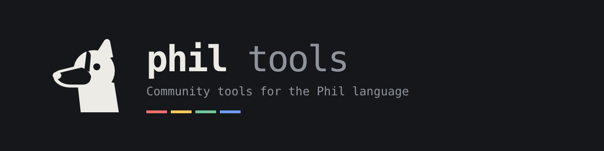

<p align="center"></p>

# Phil Tools

Open-source community tools for [Phil](https://github.com/abiggerhammer/phil), a systems language where architecture is executable and implementation is replaceable.

> **Unofficial.** This project is not part of, or endorsed by, the Phil project or its authors. Phil's own checker and documents are the authority on the language. Where these tools disagree with Phil, Phil is right and the disagreement is a bug here (please [open an issue](https://github.com/philcoinhigh/Phil-tools/issues)).

## Projects

| Project | What it is | Folder |
| --- | --- | --- |
| **Phil for VS Code** | Editor extension: highlighting, live syntax errors with codes and quick fixes, hovers, outline, snippets, formatting | [`vscode/`](vscode) |
| **Phil Playground** | Web app to write, run, replay and bug-hunt Phil programs, with examples and puzzles. Also runs Phil's own `philc` compiler, built to WebAssembly ([`philc/`](philc)) | [`playground/`](playground) |
| **Learn Phil** | A course of fifteen short lessons with code you run and fix in the page | [`site/`](site) |
| **Phil OTC desk** | An escrow desk and a two-listing order book, written in Phil. Simulation only: no real tokens move | [`otc/`](otc) |
| **Hacks Phil would have stopped** | Four well-known losses, each reduced to the shape of the mistake and refused in the page, with sources | [`core/src/sim/hacks.ts`](core/src/sim/hacks.ts) |
| **Contract library** | Vesting, a 2-of-3 treasury, an auction and a bonding-curve launch, written in Phil. Simulation only | [`contracts/`](contracts) |
| **Conformance report** | Every test program in the Phil repository, run through these tools once a day | [`conformance/`](conformance) |
| **Phil core** | The shared checker and experimental simulator, plus the command-line checker and the MCP server for AI assistants | [`core/`](core) |

Each folder has its own README. The site at <https://philcoinhigh.github.io/Phil-tools/> has a home page that links to the playground, the course and the OTC desk.

They live in one repository because they all use the same lexer and parser, written from Phil's normative grammar `grammar/phase1-surface.ebnf`; a grammar fix lands in every tool at once.

## Quick start

Requires Node.js 18 or newer.

```sh
npm install
npm run build          # extension, CLI, MCP server and playground
npm test               # typecheck, simulator examples, designer, playground and extension tests
```

### Check a file

```sh
node out/cli.js path/to/file.phil          # file:line:col: error PHIL-P007: ...
node out/cli.js --json path/to/file.phil   # machine-readable, includes quick-fix edits
node out/cli.js --format path/to/file.phil # print the re-indented file
```

Exit status is 0 with no errors, 1 with syntax errors, 2 on usage errors.

### Playground

`npm run build` writes the site to `docs/`: the home page at `docs/index.html`, the playground at `docs/playground/`, the course at `docs/learn/`, the OTC desk at `docs/otc/`, the hacks page at `docs/hacks/`, the contract library at `docs/library/` and the conformance report at `docs/conformance/`. Each page is self-contained. See [playground/README.md](playground/README.md). Open it in a browser, or serve the `docs/` folder with GitHub Pages (repository **Settings → Pages → Deploy from a branch → `main` / `docs`**).

### VS Code extension

```sh
npm run package:vscode   # writes vscode/phil-language-<version>.vsix
```

Install it from the Extensions panel: **⋯ → Install from VSIX…**. See [vscode/README.md](vscode/README.md); error codes are in [vscode/ERROR_CODES.md](vscode/ERROR_CODES.md).

### MCP server for AI assistants

Register the command `node /absolute/path/to/out/mcp.js` in an MCP client. See [core/README.md](core/README.md). Tools: `phil_check`, `phil_format`, `phil_run`, `phil_hunt`, `phil_keyword`, `phil_generate_protocol`.

## How it is tested

```sh
git clone https://github.com/abiggerhammer/phil ../phil
npm run test:corpus -- ../phil        # checker vs. every .phil file in the Phil repository
npm run test:conformance -- ../phil   # simulator vs. Phil's accepted/rejected semantic fixtures
```

- **Checker:** accepts every Grammar-v1 program in the Phil repository and rejects all 36 of its rejected-syntax fixtures. The suite also runs the highlighting grammar through VS Code's tokenizer, expands every snippet, checks the formatter never changes a token, and feeds 3,000 mutated files to the parser.
- **Simulator:** agrees with Phil's checker on 38 of the 39 semantic fixtures named `accepted*`, and flags 122 of the 197 others (measured against Phil `c3e2ed3`, 2026-11-10). Most of the rest need static type or proof checks that a run-time simulator cannot do.

## Limits you should know

- The checker validates **syntax only**. A program that parses can still be rejected by Phil for ownership, protocol, authority or proof reasons.
- The simulator is **an interpretation of Phil's published design**, not an official semantics. It checks at run time what Phil establishes statically. A program that runs here can still be rejected by Phil, and the other way round.
- The bug hunter is a **bounded search, not a proof**.
- Programs written against these tools are models. Phil's own compiler does not yet build general programs, and nothing here deploys to a blockchain.
- Simulator choices that are not Phil: host operations `lt`, `le`, `gt`, `ge`, `eq`, `ne` and `console_write` (ordinary Phil expressions have no comparison operators); inside an `offer` arm the endpoint's name refers to its next state; roles marked `external` are played by an automatic peer.

## Contributing

See [CONTRIBUTING.md](CONTRIBUTING.md). Good first contributions: example programs, puzzles, and paired passing/failing programs for the ownership gaps Phil lists in its `fsem01-coverage1-register.json`.

If you find a program that **Phil itself** wrongly accepts, do not post it here: follow the private reporting process in Phil's `SECURITY.md`.

## Credits and license

Apache-2.0, the same license as Phil. See [NOTICE](NOTICE) for attribution of material derived from the Phil repository.

Built by the Philcoin community. Contract address: `Ea5dBrJZN58yV1nm1Q4DybJNYKeTvwpb2GEkXyW64bUH`. The tools are free to use and are not gated by any token. The Phil project and its authors have no affiliation with Philcoin.
